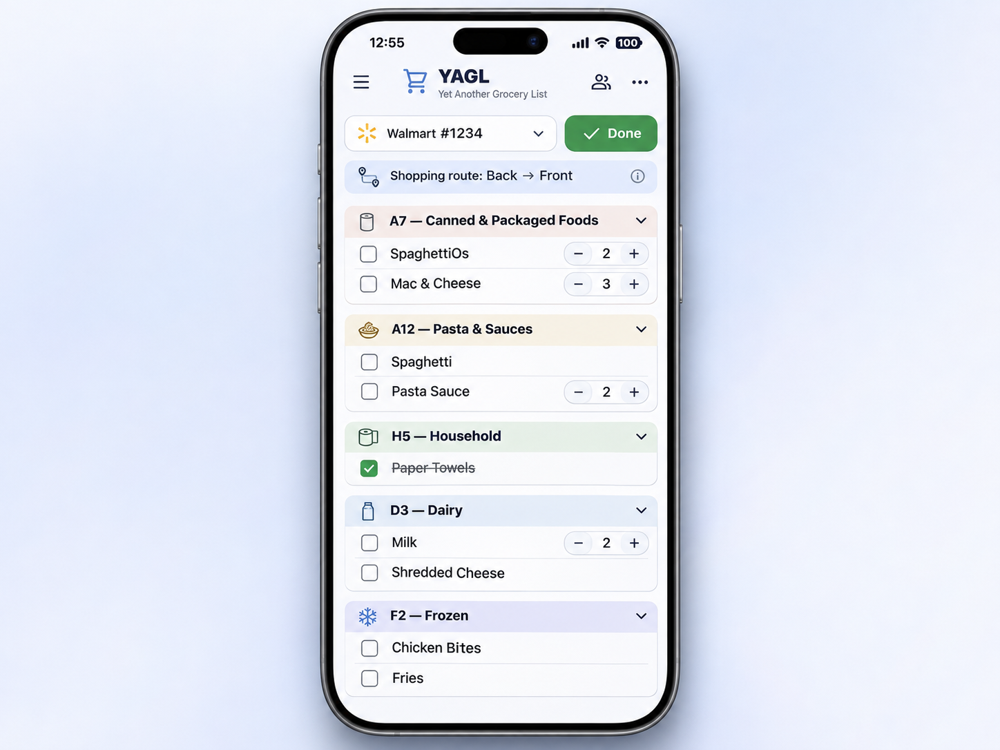

# 🛒 YAGL — Yet Another Grocery List

**Because apparently the internet needed another grocery list app. This one knows where your groceries are.**

**Version:** `v1.0.0-beta.1` (public beta) · **Status:** active beta testing · **Distribution:** free, source-available, self-hosted

YAGL is a dead-simple shared grocery/shopping list for households and homelabs. Open the same URL on your phones, check off what you've picked up, and press **Done** to clear only completed items. If you want to get fancy, teach YAGL the categories and aisle order for any store. The same list is then displayed in each browser's selected store order — independently.

No user accounts. No external product database. No telemetry. No paid API. No mandatory store setup.



*Concept preview of the shopping experience. This illustration is not a screenshot of the current beta interface.*

## Features in this beta

- **Start immediately:** add, edit, check/uncheck, and clear checked items while unchecked items persist.
- **Quantities:** items start at one (hidden); `+` increases; `−` lowers to one without deleting.
- **One shared list:** updates reach open browsers live via WebSocket, with periodic resync as fallback.
- **Independent views:** each browser remembers its own selected store while all devices share list items, quantities, and checkmarks.
- **Any retailer:** configure multiple store profiles, not just Walmart.
- **Walking order:** move aisles/zones up and down to define a real back-to-front or custom route; not alphanumeric sorting.
- **Remembered categories:** store-specific category-to-aisle mappings, matching keywords for future products, and product-specific aisle exceptions.
- **Portable layouts:** versioned JSON export and import with preview, backup reminder, merge/replace, and validation.
- **Self-hosted persistence:** one SQLite database in a Docker named volume. Single Python container, no external services.
- **Responsive UI:** works in mobile and desktop browsers.

### Beta limitations and scope

No user accounts or per-user lists, no Walmart API/third-party pricing, no image screenshot recognition, no community store-map directory, and no offline editing. Smart categories use local matching words you control, **not AI** or a live product catalog. Newly entered products that aren't recognized remain unmapped until taught. Quantities are whole counts only. This beta is not production-hardened software; back up your data and expect changes during development.

## Quick start (Docker Compose)

Prerequisites: Docker Engine with Compose plugin (`docker compose`) and an available TCP port.

```bash
git clone https://github.com/UsedOak/YAGL.git
cd YAGL
cp .env.example .env
docker compose up -d --build
```

Open `http://YOUR-SERVER-IP:8080` (or the host port you select in `.env`). The first page is already a working blank shopping list; no database or account setup is required.

To change the published host port, edit `YAGL_PORT=8080` in `.env` before starting the container. The application still listens on port `8080` inside Docker. If you install from a release archive rather than Git, extract the archive and run the setup commands inside the project folder.

### Behind an existing reverse proxy

YAGL listens on container port `8080`. Publish it through your own reverse proxy / Cloudflare Tunnel, e.g. `shopping.example.com → http://SERVER-IP:8080`. Make sure your proxy forwards **WebSocket upgrade requests** to `/api/live`. The browser uses the same host for its API and live socket. HTTPS should terminate at your proxy for public domains.

The Compose host port defaults to `8080`. To bind only on loopback for a proxy running on the same host, set `YAGL_BIND=127.0.0.1` in `.env`. For a reverse proxy on another machine, keep a reachable binding and use your firewall as appropriate.

### Update

```bash
git pull
docker compose up -d --build
```

Data survives container rebuilds in the named Docker volume, or in your chosen bind mount. Make a full database backup before updating a beta release. **Do not use `docker compose down -v`** unless you explicitly intend to erase all data.

### Optional: Unraid appdata persistence

Standard Docker Compose uses a named volume. On Unraid you can instead store the SQLite database within your appdata share, making it easier to include in your existing backup workflow. After cloning the repository, run the following from the project folder:

```bash
mkdir -p /mnt/user/appdata/yagl/data
chown 10001:10001 /mnt/user/appdata/yagl/data
cat > compose.override.yaml <<'YAML'
services:
  yagl:
    volumes:
      - /mnt/user/appdata/yagl/data:/data
YAML

docker compose up -d --build
```

Use this **before creating data in the standard named volume**. If you already have an existing YAGL database, back it up and migrate it before changing storage mounts, or the new empty location will appear to reset your list. For bind mounts, the container needs write access as UID `10001`.

### Stop and inspect

```bash
docker compose logs -f yagl
docker compose stop
docker compose up -d
```

## Initial beta testing status

YAGL has been installed and tested on an Unraid Docker host. The basic shopping list, startup, WebSocket connection, and instant changes between connected devices have been confirmed during hands-on testing. Automated backend tests and Docker startup checks have also run successfully.

Store configuration, aisle routing, imports/exports, browser compatibility, and restore workflows still need broader real-world testing. No additional bugs have been reported in the limited hands-on testing completed to date; this does **not** mean the beta is bug-free.

If the status indicator says **Reconnecting**, confirm your installation includes WebSocket support (`uvicorn[standard]` in `requirements.txt`), then check the container logs and any reverse proxy configuration. See [installation troubleshooting](docs/installation.md).

## First five minutes

1. Open YAGL on two phones/browsers and add something. Both show the same items.
2. Press `+` for multiples. A single item doesn't show a quantity.
3. Check an item. The checkbox fills, the name gets a strikethrough, and the item stays visible. Press **Done** to remove all checked items only.
4. Open **Settings → Stores**, create a profile such as `Walmart - Main Street`. Select it from the shopping-page dropdown.
5. Go to **Walking order** and add aisle/zone labels (`A20`, `A7`, `Dairy`, `Frozen`), then move them into the order you actually shop.
6. Go to **Category mapping**, assign a category such as Dry Pasta to aisle `A7`.
7. Edit any list item using the `⋯` button to set its category and, if needed, its product-specific aisle. That knowledge is remembered for later trips.
8. Open the site on the other device and select a *different* store. The list stays shared; sorting stays independent.

## Settings and memory

| Information | Where it lives |
| --- | --- |
| List items, checkmarks and quantities | Shared SQLite database |
| Store and aisle configurations | Shared SQLite database |
| Category names/keywords and product categories | Shared SQLite database |
| Your currently selected store | This browser's localStorage |

Category rules are deterministic: a previously taught product category wins, followed by the most specific matching category name/keyword. If you map **Dry Pasta → A7**, products recognized as Dry Pasta appear at A7. A named product exception overrides its category at a specific store. When Walmart reorganizes, change the category's aisle assignment to move all inheriting products. Store-specific exceptions remain independent.

**Duplicate items:** adding an exact matching name (case-insensitive) prompts whether to increase its quantity. The beta does not silently create another duplicate.

## Export and import

**Settings → Import & export** downloads a `.json` store profile containing the aisle walking order, descriptions, category assignments, product-specific locations, and relevant remembered product categories. It **does not** export your active shopping list.

**Important:** download a backup of your current store configuration before importing another. The importer previews the number of mappings and offers:

- **Merge:** add missing aisle/category/product mappings without overwriting existing ones; new aisles are appended at the end of your route.
- **Replace:** replace the selected store's aisles and location mappings with the imported layout. The target store's name and other stores are not replaced.

Export format: `yagl-store-layout` schema version `1`. Import accepts that exact format; see [Store map format](docs/store-map-format.md).

## Backups and recovery

By default your database is in the Docker named volume (`yagl_data`, usually qualified by the Compose project name). If you configured an Unraid or other bind mount, it lives at your selected host path instead. It is **not** in the Git repository. Do not rely on a raw copy of a live SQLite file while write-ahead logging is active.

A consistent SQLite backup can be made while the app is running:

```bash
docker compose exec yagl python -m backend.backup /tmp/yagl-backup.sqlite3
docker compose cp yagl:/tmp/yagl-backup.sqlite3 ./yagl-backup.sqlite3
```

For restore instructions, see [Installation and maintenance](docs/installation.md). Store-layout JSON export is useful for sharing but **not a substitute for full database backup** (it excludes your shopping list and other profiles).

## Project documentation

- [Installation, updating, and database restore](docs/installation.md)
- [Configuring stores and shopping routes](docs/configuration.md)
- [Store map JSON schema](docs/store-map-format.md)
- [Architecture and developer notes](docs/architecture.md)
- [Roadmap and scope](docs/roadmap.md)
- [Testing checklist](docs/alpha-testing.md)
- [Release notes](RELEASE_NOTES.md)
- [Changelog](CHANGELOG.md)
- [Contributing](CONTRIBUTING.md)
- [Security model](SECURITY.md)

## Security philosophy

YAGL intentionally has **no authentication**. Anyone who can reach the URL can read and change the shared list **and store configuration**. A Docker container reduces host access but is not an access-control boundary. The app does not attempt to isolate people from one another. You may place an authentication layer in front of the app using your own proxy, VPN, or Cloudflare Access if you want one. See [SECURITY.md](SECURITY.md) for details.

## License and reuse

This project uses **MIT plus Commons Clause License Condition v1.0**. You may self-host, copy, fork, improve, and freely share the software under its terms, but the Commons Clause prohibits selling it and certain paid services substantially based on it. This is **source-available**, **not OSI-approved open-source**. The Commons Clause is broader than just stopping a $0.99 app-store reskin; review [LICENSE](LICENSE) before reusing. See the LICENSE file for the complete terms and licensor details.

## Development

```bash
python -m pip install -r requirements.txt pytest httpx
YAGL_DB_PATH=/tmp/yagl-dev.sqlite3 uvicorn backend.app:app --reload --port 8080
python -m pytest -q
```

Tests use isolated temporary databases. The web interface uses plain HTML, CSS, and JS with no build pipeline.

---

*Yet Another Grocery List. It's a list. But it knows the aisle.*
